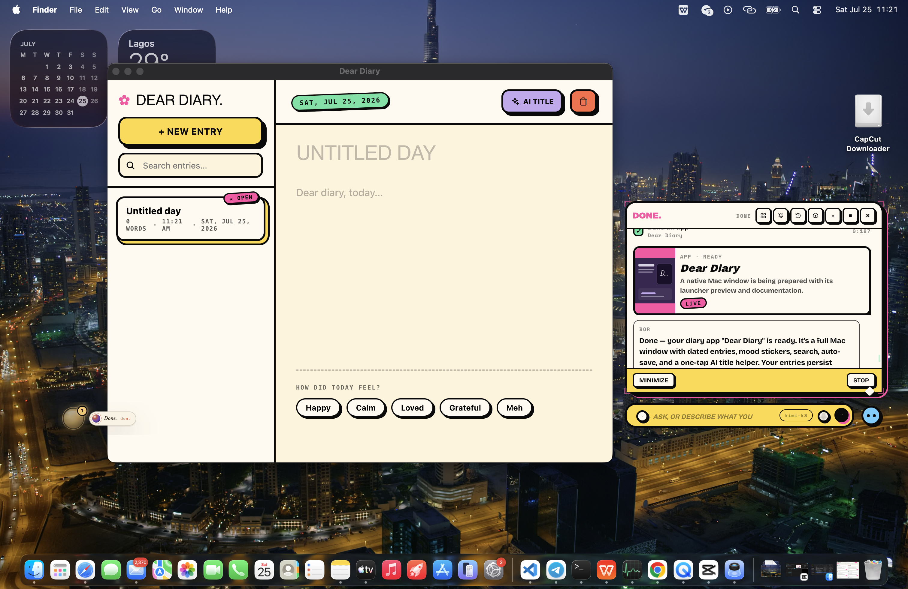
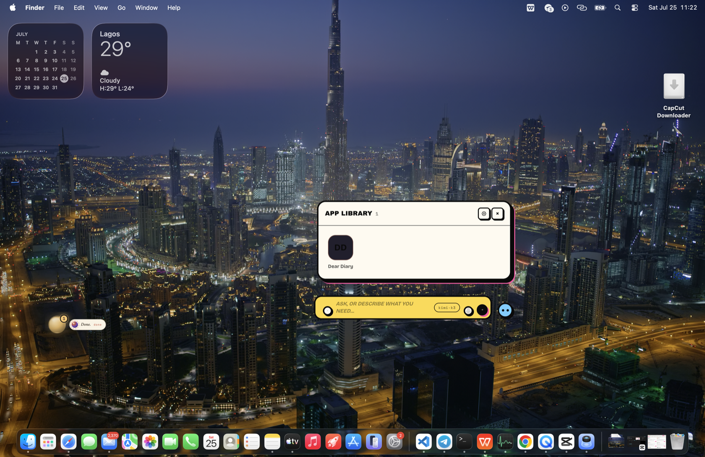
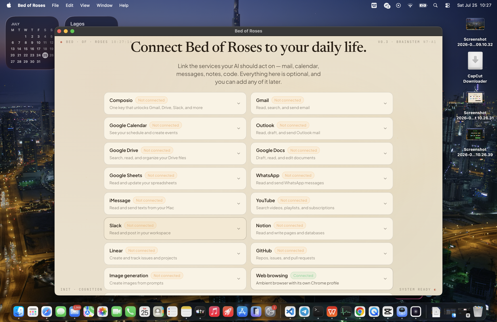
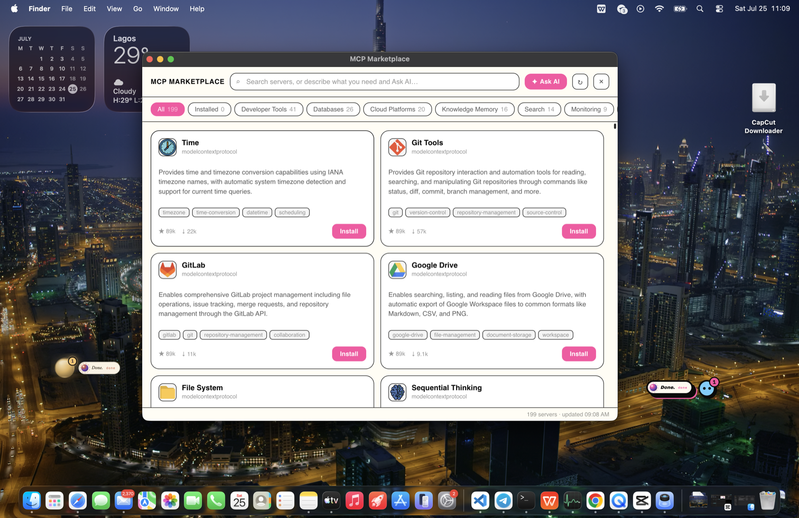
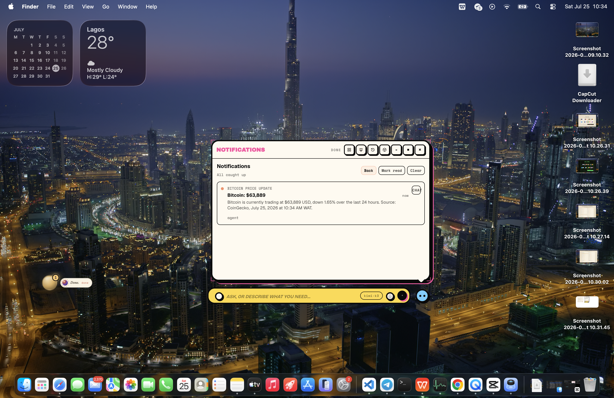
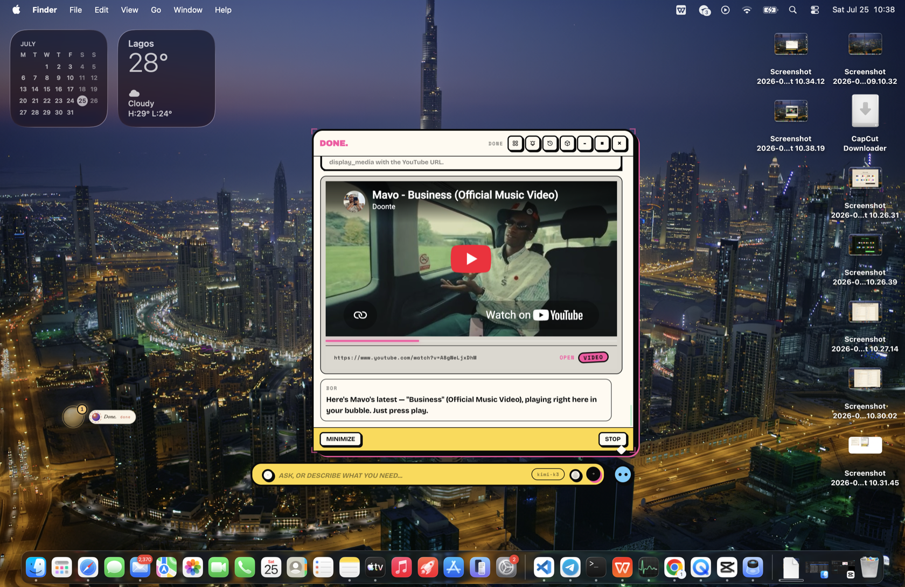
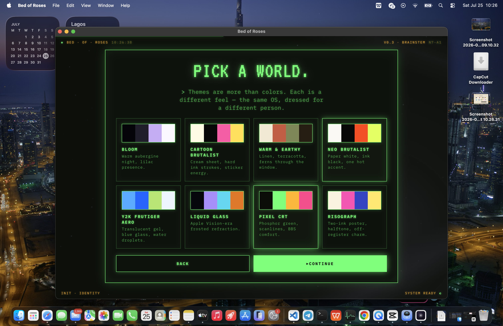
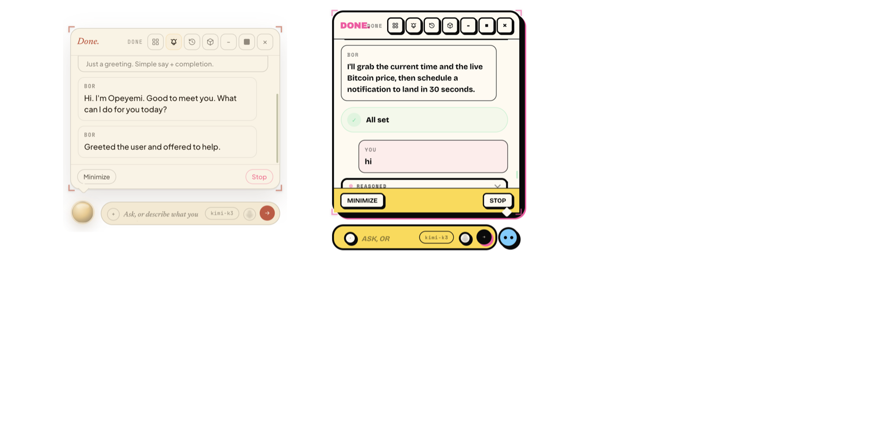

<div align="center">


# Bed of Roses

**An AI companion that lives on your desktop and does things.**

<p>
  <a href="https://www.npmjs.com/package/bed-of-roses"></a>
  <a href="https://github.com/SixHq/bed-of-roses/blob/main/LICENSE"></a>
  = 20">
  
</p>

[Quick start](#quick-start) · [Feature tour](#what-it-does) · [Documentation](https://github.com/SixHq/bed-of-roses/blob/main/docs/introduction.mdx)

</div>

---

Bed of Roses (BOR) is not a chat window. It is a small, draggable **presence** that floats above your real desktop — always on top, on every Space, one keystroke away. You tell it what you want, and it does the work in front of you: it builds you native Mac apps, connects to your email and calendar, browses the web in a real Chrome, edits your files, controls your Mac, plays media, and runs jobs while you're away. Everything runs locally on your machine, with the model of your choice.

## What it does

### Build the app you need, when you need it

Ask for a calorie tracker, a CRM, a journal, a dashboard — BOR designs it, writes it, and opens it as its own native Mac window. Apps keep their state across sessions and across redesigns, so "add a dark stats page" doesn't lose your data. Small tools can render as live cards right inside the conversation instead.



Your presence keeps track of everything it has built for you. Ask it to reopen, change, or extend any app later — it launches the exact one you mean and evolves it in place.



### Connect it to your daily life

During onboarding (and any time after), BOR shows a connectors gallery: one Composio key unlocks one-click sign-in for Gmail, Google Calendar, Drive, Docs, Sheets, Outlook, WhatsApp, YouTube, Slack, Notion, Linear, and GitHub — plus a "More apps" browser with roughly a hundred more one-click services. iMessage connects through macOS Full Disk Access. Connected services become real tools: when Gmail is linked, "reply to Sarah's email" uses Gmail directly, not a browser.



### Browse the web like a person

BOR drives a real Chrome window with its own profile. It reads pages structurally (not by squinting at pixels), clicks, types, fills multi-field forms, manages tabs, and can stay signed in to your sites. It verifies what happened on the page before it tells you it's done — and you watch it happen: the Chrome window works in the open while the presence's browser card narrates each step.

### Reach a hundred more tools through MCP

A built-in marketplace lets you browse, search, and one-click install MCP servers — databases, SaaS APIs, dev tools — and BOR wires them up itself, including build steps and API keys. Your own custom MCP servers drop into a config file and hot-reload.



### Work while you're away

BOR schedules real agent runs — "every weekday at 9, summarize my inbox" — using one-shot, interval, or cron schedules. Results land in a notifications inbox on the presence; any notification can be continued as a full conversation with one click.



### Play media where you are

Ask for a song, a video, a tweet — YouTube (including Shorts and live), Vimeo, TikTok, Instagram posts and reels, tweets, images, and video files play as cards inside the presence. No app-switching to see what BOR found.



### Make it yours

Eight full themes — from Bloom's quiet default to Pixel CRT's green phosphor terminal — restyle the presence, every card, and every app BOR generates. Ask for a new wallpaper and BOR generates one and sets it as your actual macOS desktop. Name your AI, pick its presence style and color, give it a personality.



### Run as many presences as you like

Each presence is a fully separate companion — its own model, memory, apps, connectors, theme, and personality. A work presence on Claude and a home presence on Gemini can run side by side without sharing anything.




### And the rest

- **Watch it think.** The thought bubble streams reasoning cards, code editors filling in line by line, terminal output, MCP calls, and browser sessions as they happen. Stop any task with one click; press play to resume exactly where it left off. History reopens past conversations with every card intact.
- **Your files, any format.** BOR reads PDF, Word, Excel, PowerPoint, Jupyter notebooks, images (including HEIC and PSD), audio and video metadata, archives, and text in any encoding. Drag any file onto the presence to attach it. File paths BOR mentions are clickable and reveal in Finder.
- **Your Mac, hands on.** Screen capture, vision-guided clicking and typing, opening apps — for the things that aren't on the web and aren't in a file.
- **It remembers you.** Durable memory across sessions, plus Markdown "skills" that teach it your procedures.
- **Your model, your rules.** Anthropic, OpenAI, Google Gemini, or any OpenAI-compatible endpoint (DeepSeek, Kimi, Z.ai, Ollama, and more, with one-click presets) — with a reasoning-effort dial per provider and a model switcher right in the input bar.
- **Local first.** Everything runs on your machine at `127.0.0.1`. Keys stay in local config. Generated apps are sandboxed. Every action lands in an append-only audit log.

## Quick start

Requires **macOS** and **Node ≥ 20**.

```bash
npm install -g bed-of-roses
bor onboard
```

`bor onboard` walks you through naming your AI, picking a theme and presence, connecting a model, and linking your services. Then the orb appears over your desktop and you start talking. Prefer not to install globally? `npx bor` works too.

From a clone:

```bash
git clone https://github.com/SixHq/bed-of-roses
cd bed-of-roses
npm install
npm start
```

## Documentation

Full docs live in [`docs/`](https://github.com/SixHq/bed-of-roses/blob/main/docs/introduction.mdx) — installation, an onboarding walkthrough, and a page per capability: [the presence](https://github.com/SixHq/bed-of-roses/blob/main/docs/features/presence.mdx), [building apps](https://github.com/SixHq/bed-of-roses/blob/main/docs/features/building-apps.mdx), [connectors](https://github.com/SixHq/bed-of-roses/blob/main/docs/features/connectors.mdx), [the ambient browser](https://github.com/SixHq/bed-of-roses/blob/main/docs/features/ambient-browser.mdx), [files](https://github.com/SixHq/bed-of-roses/blob/main/docs/features/files.mdx), [computer use](https://github.com/SixHq/bed-of-roses/blob/main/docs/features/computer-use.mdx), [media](https://github.com/SixHq/bed-of-roses/blob/main/docs/features/media.mdx), [themes](https://github.com/SixHq/bed-of-roses/blob/main/docs/features/themes.mdx), [background tasks](https://github.com/SixHq/bed-of-roses/blob/main/docs/features/background-tasks.mdx), [memory & skills](https://github.com/SixHq/bed-of-roses/blob/main/docs/features/memory-and-skills.mdx), and [multi-presence](https://github.com/SixHq/bed-of-roses/blob/main/docs/features/multi-presence.mdx).

Developing or contributing? Start with [CONTRIBUTING.md](https://github.com/SixHq/bed-of-roses/blob/main/CONTRIBUTING.md) and [CLAUDE.md](https://github.com/SixHq/bed-of-roses/blob/main/CLAUDE.md) for the architecture view.

## Security

Report vulnerabilities privately per [SECURITY.md](SECURITY.md).

## License

[Apache-2.0](https://github.com/SixHq/bed-of-roses/blob/main/LICENSE) © SixHq. See [NOTICE](https://github.com/SixHq/bed-of-roses/blob/main/NOTICE).

Built on [Electron](https://www.electronjs.org/), [Playwright](https://playwright.dev/), the [Model Context Protocol](https://modelcontextprotocol.io), and the Anthropic / OpenAI / Google / DeepSeek model ecosystems.
