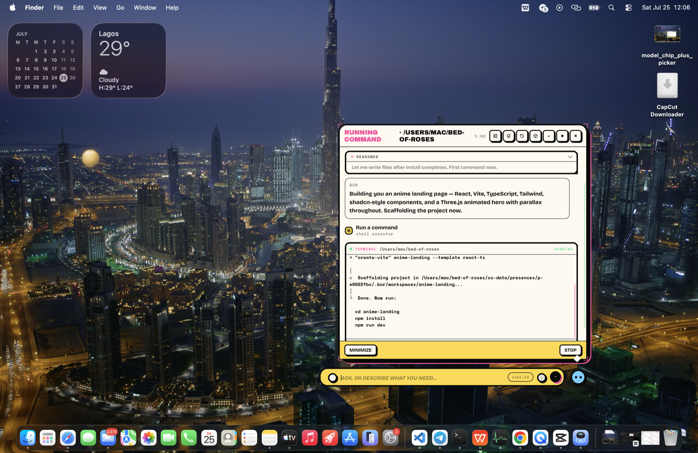
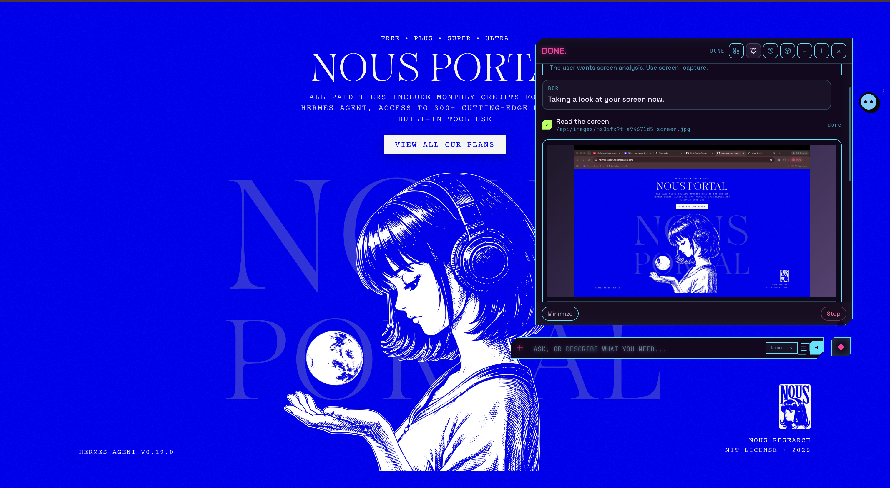

<div align="center">


# 🌹 Bed of Roses

**An AI companion that lives on your desktop and does things.**

<p>
  <a href="https://www.npmjs.com/package/bed-of-roses"></a>
  <a href="https://www.npmjs.com/package/bed-of-roses"></a>
  <a href="https://github.com/SixHq/bed-of-roses/blob/main/LICENSE"></a>
  = 20">
  
</p>

<p>
  <a href="#-the-problem">Problem</a> •
  <a href="#-the-solution">Solution</a> •
  <a href="#-installation">Install</a> •
  <a href="#-how-it-works">How it works</a> •
  <a href="#-features">Features</a> •
  <a href="#-why-bed-of-roses">Why BOR</a> •
  <a href="https://github.com/SixHq/bed-of-roses/discussions">Discussions</a>
</p>

</div>

---

## 🔥 The Problem

Every AI assistant today lives in the wrong place: **a chat window**.

<table>
<tr>
<td width="50%">

### What Happens Now

1. You open a browser tab, type a prompt
2. The AI answers **in text** — code you must copy, steps you must follow
3. You tab-switch to actually do the work yourself
4. The results die in the scrollback
5. Tomorrow you re-explain everything from zero
6. Your "assistant" never touched your actual computer

</td>
<td width="50%">

### What You Actually Want

- An AI **on your desktop**, not behind a tab
- One that **does the work** — builds the app, sends the email, runs the job
- Work you can **watch happening** — files, terminals, browsers, live
- Results that **persist** — apps you keep, memory that survives
- Your services **connected** — mail, calendar, chat, code
- **Your model, your machine, your keys**

</td>
</tr>
</table>

---

## ✨ The Solution

<div align="center">

### Bed of Roses is a small, draggable presence that floats above your real desktop — always on top, on every Space, one keystroke away. You tell it what you want. It does the work in front of you.

</div>

It builds you native Mac apps, connects to your Gmail and calendar, browses the web in a real Chrome, reads and writes your files, controls your Mac, plays media, and runs scheduled jobs while you're away — **and you watch every step of it happen** in a live thought bubble of streaming reasoning, code editors, and terminals.

| | Chat assistants | **Bed of Roses** |
|---|---|---|
| Lives | in a browser tab | **on your desktop, above every app** |
| Output | text you act on | **actions it performs** |
| Apps | describes code | **ships native Mac windows that persist** |
| Email | drafts you copy-paste | **sends through your connected Gmail** |
| Web | quotes pages | **drives a real Chrome, verifies results** |
| Between sessions | amnesia | **memory, apps, history, skills** |
| Model | theirs | **yours — any provider, any key** |
| Runs | on their servers | **100% on your machine** |

---

## 🚀 Installation

Requires **macOS** and **Node ≥ 20**.

```bash
npm install -g bed-of-roses
bor onboard
```

That's it. `bor onboard` walks you through naming your AI, picking one of eleven themes, choosing a presence style, connecting a model, and linking your services. Then the orb appears over your desktop and you start talking.

### From source

```bash
git clone https://github.com/SixHq/bed-of-roses
cd bed-of-roses
npm install
npm start
```

### The `bor` CLI

| Command | What it does |
|---|---|
| `bor` | Launch Bed of Roses (all your presences) |
| `bor onboard` | Launch and create a new presence with onboarding |
| `bor create [name]` | Register a new presence headlessly |
| `bor list` | List presences and their onboarding state |
| `bor delete <id>` | Delete a presence and its data |
| `bor --help` | Show usage |

### Bring your own model

Works with **Anthropic** (Claude), **OpenAI** (GPT), **Google** (Gemini), or **any OpenAI-compatible endpoint** — one-click presets for **DeepSeek**, **Kimi / Moonshot**, **Z.ai (GLM)**, and **Ollama** for fully-local models. Every provider gets a reasoning-effort dial (Off → Max), and you can switch models mid-conversation from a chip in the input bar.

---

## 🎯 How It Works

| Step | What Happens |
|---|---|
| **1. Summon** | Click the orb or press **⌘⌥Space** — the composer opens over whatever you're doing |
| **2. Ask** | "Build me a calorie tracker", "Reply to Sarah's email", "Every morning at 8, brief me" |
| **3. Watch** | A thought bubble streams the work live: reasoning cards, code filling in line by line, terminal output, browser steps, MCP calls |
| **4. Interrupt freely** | Stop any task with one click — press **Resume** and it picks up exactly where it left off |
| **5. Get real results** | A native app window opens. The email is *sent*. The file is on disk — its path clickable, revealing in Finder |
| **6. Walk away** | Scheduled jobs keep running; results land in a notifications inbox on the orb |
| **7. Continue anywhere** | Any notification or past conversation reopens as a full thread — every card intact — and you keep going |

---

## 🛠 Features

### 🫧 The Presence & the Thought Bubble

The core of BOR is the *presence* — a floating orb that's always one glance away, and its thought bubble, where work happens in public.



| Card | What streams into it |
|---|---|
| **Reasoning cards** | The model's thinking, token by token — collapsible, ignorable, honest |
| **Editor cards** | Every file written, line by line, with path, live caret, diff stats, saved/failed status |
| **Terminal cards** | Commands with `$` prompt, live stdout/stderr, working directory, exit status |
| **Browser cards** | Web sessions: current page, action narration, expandable console |
| **MCP cards** | Calls to connected services, arguments streaming as they're composed |
| **Build cards** | Apps and shortcuts under construction, then going live |
| **Media cards** | Videos, images, tweets playing inline |

Plus: the bubble is resizable from all eight edges, minimizes to a chip while work continues, **stop/resume** with full context preservation, a **+** for a fresh thread, and a history that restores past conversations *with every card intact* — reopening a conversation is a real resume, not a transcript.

---

### 📱 Build the App You Need, When You Need It

Ask for a calorie tracker, a CRM, a habit journal, a dashboard — BOR researches what a *good* one looks like, designs it, writes it, and opens it as its own native Mac window.


| Feature | Description |
|---|---|
| **Native windows** | Generated apps open as real macOS windows, not web tabs |
| **Persistent state** | Apps keep their data across sessions *and across redesigns* — "add a dark stats page" doesn't lose your entries |
| **Evolvable** | Ask for changes later; BOR updates the exact app you mean, in place |
| **Sandboxed** | Every generated surface runs in an isolated sandbox with a validated bridge |
| **Live cards** | Small tools can render as interactive cards inside the conversation instead |

Your presence keeps a library of everything it has built and can relaunch, update, or extend any of it on request.


---

### 🔗 Connect It to Your Daily Life

During onboarding (and any time after), BOR shows a connectors gallery. **One Composio key unlocks one-click OAuth** for the services you live in — and connected services become *real tools*: when Gmail is linked, "reply to Sarah" uses Gmail directly, never a browser.


| Connector | How it connects |
|---|---|
| **Gmail, Google Calendar, Drive, Docs, Sheets** | One-click Google sign-in (Composio-managed OAuth) |
| **Outlook** | One-click Microsoft sign-in |
| **WhatsApp, YouTube, Linear** | One-click OAuth |
| **Slack, Notion, GitHub** | One-click OAuth — or paste an API token if you prefer |
| **iMessage** | Local-only: grant Full Disk Access, your messages never leave the machine |
| **~100 more services** | A searchable "More apps" browser with the same one-click flow |
| **Image generation** | Lights up automatically from your existing model keys |

Everything is verify-then-persist: a credential is live-probed against the real API before it's saved, and secrets never leave your local config.

---

### 🌐 Browse the Web Like a Person

BOR drives a **real, visible Chrome window** with its own persistent profile — separate from your personal browser.

| Feature | Description |
|---|---|
| **Structural page reading** | After every action BOR gets an accessibility snapshot — every link, button, field precisely identified. No pixel-guessing |
| **Acts by reference** | Clicks, typing, key presses, dropdowns, multi-field form fills, tabs, back, waiting |
| **Stays signed in** | Its own profile persists logins across sessions |
| **Verified results** | BOR checks the page state *after* acting before it claims success |
| **Watch it work** | The Chrome window works in the open while a browser card narrates each step |

Plus classic **web search** and **page fetch** for quick reads, and the browser-use CLI as an optional power-user fallback.

---

### 🖱 Your Mac, Hands On

For everything that isn't on the web and isn't in a file — "rename these layers in Figma", "click Run in Xcode" — BOR uses your Mac the way you do.



| Step | Description |
|---|---|
| **It looks** | Captures the screen — hiding its own orb first, so it sees your apps, not itself |
| **It finds** | A vision model locates the element you described and returns exact coordinates |
| **It acts** | Real clicks, real typing, real keyboard shortcuts, opening apps by name |
| **You see everything** | Every capture appears as a card in the bubble — you always know what it saw |

---

### 📂 Your Files, Any Format

Drag any file onto the presence — or click a path in any reply to reveal it in Finder.

| Capability | Details |
|---|---|
| **Reads almost anything** | PDF, Word, Excel/CSV, PowerPoint, Jupyter notebooks, images (HEIC, PSD, TIFF included), audio & video metadata, archives, source code, text in any encoding |
| **Writes and edits** | Full and surgical file edits, with every change streaming into an editor card |
| **Drag & drop attach** | Files, images, folders, fresh screenshots — dropped straight onto the orb |
| **Clickable paths** | Every path BOR mentions is a link that reveals the file in Finder |
| **Safe roots** | BOR's own artifacts live under a working directory; it refuses to write into its own source or outside your home |

---

### 🎵 Play Media Where You Are

YouTube (including Shorts and live), Vimeo, TikTok, Instagram posts and reels, tweets, images, and video files play as cards inside the presence. No app-switching to see what BOR found.


---

### ⏰ Work While You're Away

BOR schedules real agent runs — not reminders, actual work.


| Feature | Description |
|---|---|
| **One-shot, interval, or cron** | "Every weekday at 9, summarize my inbox" becomes a real scheduled agent run |
| **Notifications inbox** | Results land behind the bell; unread counts show on the orb even when collapsed |
| **Continue in chat** | One click turns any notification into a full conversation seeded with its content |
| **Background tasks** | Long work keeps running while the bubble is minimized to a chip |

---

### 🧠 It Remembers You

| Feature | Description |
|---|---|
| **Durable memory** | Facts about you, your preferences, and your projects survive across sessions |
| **Skills** | Markdown files that teach BOR your procedures — drop them in a folder, they load into its head |
| **Conversation history** | Every thread reopens with its cards, terminals, and reasoning intact |

---

### 🏪 A Hundred More Tools Through MCP

A built-in **MCP marketplace** lets you browse, search, and one-click install Model Context Protocol servers — databases, SaaS APIs, dev tools — and BOR wires them up itself, including build steps and API keys.


Your own custom MCP servers (stdio, SSE, or streamable-HTTP) drop into a config file and hot-reload — no restart.

---

### 🎨 Make It Yours

**Eleven full themes** restyle the presence, every card, and every app BOR generates — the AI reads each theme's design handbook before it builds anything, so generated apps match your world.


| Theme | Feel |
|---|---|
| **Bloom** | Warm aubergine night, lilac presence — the quiet default |
| **Cartoon Brutalist** | Cream paper, hard ink strokes, sticker energy |
| **Warm & Earthy** | Linen, terracotta, ferns through the window |
| **Neo Brutalist** | Paper white, ink black, one hot accent |
| **Y2K Frutiger Aero** | Translucent gel, blue glass, water droplets |
| **Liquid Glass** | Vision-era frosted refraction |
| **Pixel CRT** | Phosphor green, scanlines, BBS comfort |
| **Risograph** | Two-ink poster, halftone, off-register charm |
| **Solarpunk** | Sun-warmed cream, moss and terracotta, living tech |
| **Cyberpunk** | Neon-noir panels, cyan wireframe, magenta signal |
| **Memphis** | Squiggles, clashing brights, hard ink outlines |

Ask for a new wallpaper and BOR generates one and sets it as your **actual macOS desktop**. Name your AI, pick its orb style and color, give it a personality.

---

### 👥 Run as Many Presences as You Like

Each presence is a fully separate companion — its own model, memory, apps, connectors, theme, and personality, on its own isolated runtime.


A work presence on Claude and a home presence on Kimi run side by side without sharing anything — and they all work **in parallel**. A manager window lists every presence with creation, deletion, and per-presence logs.

---

## ⌨️ Everyday Interactions

| Interaction | What it does |
|---|---|
| **⌘⌥Space** | Summon / dismiss the presence |
| **Click the orb** | Open the composer |
| **Drag a file onto the orb** | Attach it as context |
| **☰ menu in the input bar** | Notifications, History, MCP Marketplace, App Library, New Presence — without opening a chat |
| **Model chip** | Switch provider/model mid-conversation |
| **Stop → Resume** | Cancel a task; resume later exactly where it stopped |
| **+ in the bubble** | Fresh thread (the old one stays in History) |
| **Click any file path** | Reveal in Finder |

---

## 🔐 Local First, Yours First

| Principle | How |
|---|---|
| **Runs on your machine** | Everything at `127.0.0.1` — the runtime, your data, your apps |
| **Your keys, local config** | Provider keys and connector credentials never leave your Mac |
| **Sandboxed surfaces** | Generated apps run in isolated sandboxes; all I/O goes through a validated bridge |
| **Audited** | Every state-changing action lands in an append-only audit log |
| **Guarded execution** | Static command validation refuses destructive patterns before they run |
| **Open source** | Apache-2.0, all of it readable |

---

## 💪 Why Bed of Roses?

### For your day

- **It ends copy-paste AI.** The distance between "asked" and "done" is zero — the work happens on your machine, by the AI, visibly.
- **It compounds.** Apps persist, memory persists, connections persist. Day 30 BOR knows your world; a chat tab starts from zero every morning.
- **It's honest.** Streaming reasoning, live terminals, verified browser results, an audit log. You never wonder what it did.
- **It's yours.** Your model choice (including fully-local via Ollama), your keys, your data, your aesthetic.

### For the ecosystem

- **Provider-agnostic by design** — first-class support for smaller and open models (DeepSeek, Kimi, GLM), not just the giants.
- **MCP-native** — the marketplace and custom-server support make BOR a living host for the open tool ecosystem.
- **A real agent harness** — streaming XML tool protocol, multi-pass execution, mid-stream failure recovery, stop/resume — built in the open for anyone to learn from.

---

## 🧑‍💻 Development

```bash
git clone https://github.com/SixHq/bed-of-roses
cd bed-of-roses
npm install
npm start          # Electron host (spawns the runtime)
npm run server     # runtime only, at http://localhost:7777
```

| Piece | What it is |
|---|---|
| **`host/`** | Electron host — presence window, native app windows, onboarding |
| **`server/`** | Node runtime — LLM harness, tool executor, connectors, MCP, files |
| **`shell/`** | Onboarding UI and themes |
| **`docs/`** | User documentation ([start here](https://github.com/SixHq/bed-of-roses/tree/main/docs)) |

Architecture deep-dive: [CONTRIBUTING.md](https://github.com/SixHq/bed-of-roses/blob/main/CONTRIBUTING.md) and [CLAUDE.md](https://github.com/SixHq/bed-of-roses/blob/main/CLAUDE.md).

---

## 🤝 Contributing

Bed of Roses is open source and we welcome contributions!

- 🐛 **Report bugs** at [GitHub Issues](https://github.com/SixHq/bed-of-roses/issues)
- 💡 **Suggest features** at [GitHub Discussions](https://github.com/SixHq/bed-of-roses/discussions)
- 📖 **Improve docs** — PRs welcome
- 🎨 **Design a theme** — see [adding a theme](https://github.com/SixHq/bed-of-roses/blob/main/docs/contributing/adding-a-theme.mdx)
- 🔧 **Contribute code** — see [CONTRIBUTING.md](https://github.com/SixHq/bed-of-roses/blob/main/CONTRIBUTING.md)

All contributions are appreciated, no matter how small.

---

## 📄 License

Apache-2.0 — see [LICENSE](https://github.com/SixHq/bed-of-roses/blob/main/LICENSE) and [NOTICE](https://github.com/SixHq/bed-of-roses/blob/main/NOTICE).

---

<div align="center">
  <br>
  Built by <a href="https://trysixth.com"><strong>Sixth</strong></a>
  <br><br>
  Also from Sixth: <a href="https://github.com/SixHq/Overture"><strong>Overture</strong></a> — see the plan before the code — and <a href="https://marketplace.visualstudio.com/items?itemName=Sixth.sixth-ai"><strong>Sixth for VS Code</strong></a>.
  <br><br>
  <sub>Stop chatting with AI. Start living with one.</sub>
</div>

## Star History

[](https://www.star-history.com/#SixHq/bed-of-roses&type=date&legend=top-left)
